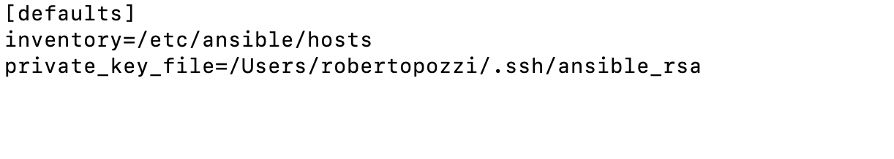

# Raspberry Pi automation
[](https://github.com/robipozzi/windfire-raspberry/actions/workflows/ci.yml)

- [Introduction](#introduction)
- [Ansible configuration setup](#Ansible-configuration-setup)
- [Installation automation task](#Installation-automation-task)
    - [Grafana Cloud configuration](#Grafana-Cloud-configuration)
    - [Windfire infrastructure configuration automation task](#Windfire-infrastructure-configuration-automation-task)
        - [UFW rules as code](#UFW-rules-as-code)
    - [Cloudflare Tunnel configuration automation task](#Cloudflare-Tunnel-configuration-automation-task)
    - [Basic web infrastructure installation automation task](#Basic-web-infrastructure-installation-automation-task)
    - [Docker installation automation task](#Docker-installation-automation-task)
- [CI and dependency monitoring](#CI-and-dependency-monitoring)
- [Projects](#projects)
    - [Home Automation](#home-automation)
- [References](#References)

## Introduction
This repository holds scripts, playbooks and configurations to automate infrastructure configuration tasks on Raspberry Pi boards.

## Ansible configuration setup
The scripts provided are based on Ansible technology (https://www.ansible.com/) for task automation; refer to Ansible technical 
documentation (https://docs.ansible.com/) for detailed instructions regarding installation and setup.

Ansible uses ssh to connect to the managed infrastructure, so you will first need to generate an ssh key pair; the script *[ansible-initialize.sh](ansible-initialize.sh)*, provided in the root folder of this repo, copies the public ssh key to a remote destination (you will need to pass it as a parameter when you launch the script), assuming you generated a key called *ansible_rsa* and saved it in *.ssh* sub-folder under your user home directory.

If `ansible_rsa` has a passphrase, every script here that runs Ansible loads it into a private `ssh-agent` through `runWithAnsibleSshKey` in [setenv.sh](setenv.sh). On macOS it uses Apple's `/usr/bin/ssh-add --apple-use-keychain`, so the passphrase is asked on the first run, saved in your login Keychain and read from there afterwards. Elsewhere it is asked on every run.

A file, named *[ansible.cfg](ansible.cfg)*, is also provided to set basic configurations needed to run Ansible; if you launch Ansible from the repo root directory, this file will be read and used as the source for configuration settings (unless you have set an ANSIBLE_CONFIG environment variable, which has precedence), the basic configuration you should have is something like this:


where:

* *inventory* defines where Ansible will look for the inventory file, which is used by Ansible to know which servers to connect and manage.
* *private_key_file* points to the SSH private key you have previously generated, used by Ansible to connect and launch tasks on the target Raspberry Pi;

Change the parameters according to your environment.

## Installation automation task
The **[raspberry.yaml](raspberry.yaml)** playbook is provided to do the following basic tasks on all Raspberry boxes consistently:

    * update package manager repo cache and upgrade installed packages on all Raspberry Pi boxes
    * install OpenSSL on all Raspberry Pi boxes
    * install and configure Grafana Cloud Alloy, which ships to Grafana Cloud (see [Grafana Cloud configuration](#Grafana-Cloud-configuration)):
        * node metrics; the systemd collector reports only the keycloak, alloy and windfire-* units
        * only the systemd journal of the units listed in *alloy_journal_units* and the kernel "[UFW BLOCK]" lines; /var/log is not read
        * lines that look like they hold a secret (password, passwd, secret, token, authorization, api_key / api-key / apikey, client_secret, any case) are dropped before they leave the Pi
    * install UFW and allow SSH (22/tcp) from the admin laptop (*admin_ip*); on a new Pi (UFW not active) also set default deny incoming / allow outgoing and enable UFW, so only SSH from the laptop gets in; on a Pi where UFW is already active the other rules and the defaults are not changed
    * install Chrony for time synchronization (it replaces systemd-timesyncd)
    * install the Smallstep step CLI (step-cli) from the Smallstep apt repository
    * enable unattended security upgrades, also allowing the Raspberry Pi Foundation origin, with needrestart set to restart services automatically
    * harden the pi admin account: sudo always asks for pi's password (passwordless sudo rule removed)
    * harden SSH (/etc/ssh/sshd_config.d/10-hardening.conf): key-only login, no root login, only pi allowed

UFW is enabled only when the playbook runs from *admin_ip*, otherwise it stops before enabling it; note that a Pi where UFW was deliberately disabled counts as new, so UFW gets enabled there too.
Before changing pi and SSH, the playbook stops if pi has no (or an empty) *authorized_keys* file or no usable password, so a box cannot be locked out.
At the end it checks the result on every box:

    * Chrony is synchronized (and shows the System time offset of each box)
    * unattended-upgrades allows the Debian-Security and Raspberry Pi Foundation origins
    * UFW is active, denies incoming traffic by default and allows SSH from *admin_ip*
    * the effective sshd configuration (sshd -T) is hardened
    * a password login from the control machine is refused with "Permission denied (publickey)"

**Keep an existing SSH session to each Pi open until the playbook's checks pass**, so you can fix things if something goes wrong.
Sudo on the Pis needs pi's password: Ansible asks for it once per run (BECOME password, *become_ask_pass* in *[ansible.cfg](ansible.cfg)*).

A convenient scripts **[install.sh](install.sh)** is provided, using *[raspberry.yaml](raspberry.yaml)* playbook to consistently configure Raspberry Pi boxes.

Playbook refers to **[config.yml](conf/config.yml)** yaml file provided in *[conf](conf)* sub-folder for common variables setup and usage, and to *conf/grafana.yml* for the Grafana Cloud details (see below).

### Grafana Cloud configuration
The Grafana Cloud URLs and usernames are not stored in the repository. Before the first run:

1. copy *[conf/grafana.yml_PLACEHOLDER](conf/grafana.yml_PLACEHOLDER)* to *conf/grafana.yml*: `cp conf/grafana.yml_PLACEHOLDER conf/grafana.yml`
2. replace the dummy values with the details of your Grafana Cloud stack (grafana.com > My Account > your stack > Details):

| Variable | Value |
|---|---|
| *grafana_fleet_url*, *grafana_fleet_user* | Fleet Management URL and username (Alloy *remotecfg*) |
| *grafana_prom_url*, *grafana_prom_user* | Prometheus remote write URL (ending in /api/prom/push) and username |
| *grafana_loki_url*, *grafana_loki_user* | Loki push URL (ending in /loki/api/v1/push) and username |

*conf/grafana.yml* is in *[.gitignore](.gitignore)*: never commit it. The playbook stops before touching any Pi if the file is missing.

The Grafana Cloud API key is read from the *GCLOUD_RW_API_KEY* environment variable, never from the command line: *[install.sh](install.sh)* asks for it and exports it; if you run `ansible-playbook raspberry.yaml` directly, run `read -rs GCLOUD_RW_API_KEY && export GCLOUD_RW_API_KEY` first. The playbook stops if the variable is empty.

Logs shipped by Alloy:

* the systemd journal of the units listed in *alloy_journal_units* in *[config.yml](conf/config.yml)* (keycloak, windfire-security, windfire-calendar, windfire-restaurants-backend, windfire-ui-react, ssh, unattended-upgrades and cloudflared by default); to ship another unit, add its name (e.g. *myapp.service*) to the list and run the playbook again
* kernel lines that contain "[UFW BLOCK]" (connections blocked by UFW); other kernel lines are dropped
* nothing from /var/log: the journal already holds those messages

The first stage drops any line matching `(?i)(password|passwd|secret|token|authorization|api[_-]?key|client_secret)`; then kernel lines without "[UFW BLOCK]" are dropped. Dropped lines are counted by Alloy in the *loki_process_dropped_lines_total* metric, with *reason* "sensitive_content" (secret-looking lines) or "kernel_not_ufw_block" (other kernel lines); check it on the Pi with `curl -s localhost:12345/metrics | grep loki_process_dropped_lines_total`.

### Firewall and SSH lockout recovery
The UFW rules rely on the DHCP reservations of these IPs on the home router (variables in *[config.yml](conf/config.yml)*):

| Variable | Host | IP |
|---|---|---|
| *admin_ip* | admin laptop | 192.168.1.27 |
| *raspberry01_ip* | raspberry01 | 192.168.1.18 |
| *raspberry02_ip* | raspberry02 | 192.168.1.2 |
| *pi_core_ip* | pi-core | 192.168.1.10 |

All four are used by the per-host rules in *ufw_rules* (see [UFW rules as code](#UFW-rules-as-code)); *raspberry01_ip* lets the Cloudflare Tunnel on raspberry01 reach windfire-restaurants-backend on raspberry02 (8081).

If a reservation is lost or changed (e.g. the laptop gets a different IP), SSH from the laptop is blocked: restore the reservation, or update the variables and run the playbooks again (*[install.sh](install.sh)*, then *[configure-windfire-infra.sh](configure-windfire-infra.sh)*).

If SSH is locked out:

1. connect a monitor and keyboard to the Pi and log in as *pi* on the local console
2. run `sudo ufw disable`
3. fix the IP reservation, or allow the new IP: `sudo ufw allow from <ip> to any port 22 proto tcp comment 'SSH from admin laptop'`
4. run `sudo ufw enable` and, before logging out of the console, check from a new SSH session that you can log in (`sudo ufw status verbose` shows the rules)

### Windfire infrastructure configuration automation task
Once Raspberry Pi boxes are installed and configured with the common basic software stack (*[raspberry.yaml](raspberry.yaml)*), the Windfire infrastructure is configured on top of it: the UFW rules of each box and, for each specific box (e.g.: *appserver*, *calendar_service*, ...), a specific software stack.
<!-- windfire-maps retired (F20): the maps_service example above was
     (e.g.: *appserver*, *maps_service*, *calendar_service*, ...) -->

The **[raspberry-configure-windfire-infra.yaml](raspberry-configure-windfire-infra.yaml)** playbook is provided to do the following tasks on specific Raspberry boxes consistently:

    * ensure the UFW rules listed for each box in ufw_rules (see UFW rules as code below)
    * install the Windfire CA certificates in /etc/windfire/ca on all boxes (see Windfire CA certificates below)
    * install OpenJDK on all appserver Raspberry Pi boxes

<!-- windfire-maps retired (F20): the maps_service play is commented out in the playbook
    * install NodeJS, npm and pm2 on all maps_service Raspberry Pi boxes
-->

A convenient script **[configure-windfire-infra.sh](configure-windfire-infra.sh)** is provided, using *[raspberry-configure-windfire-infra.yaml](raspberry-configure-windfire-infra.yaml)* playbook to consistently configure the Windfire infrastructure on the Raspberry Pi boxes; any extra argument is passed to *ansible-playbook* (e.g. `--check --diff`, `-e ufw_prune_unlisted=true`).

Each play has a tag, so one part can be run alone with `--tags`:

| Tag | Play |
|---|---|
| `ufw` | UFW rules of every box (see UFW rules as code below) |
| `windfire_ca` | the shared Windfire CA certificates in `/etc/windfire/ca` (see Windfire CA certificates below) |
| `java` | apt update and dist-upgrade, then OpenJDK, on the appserver boxes |

Run *[install.sh](install.sh)* (*[raspberry.yaml](raspberry.yaml)*) first: the UFW play stops on a box where UFW is not active.

#### UFW rules as code
The UFW rules of each box are listed in *ufw_rules* in *[config.yml](conf/config.yml)*, one list per host (inventory name); each rule has:

| Key | Value |
|---|---|
| *port* | port, e.g. '8443' (quoted) |
| *proto* | tcp, udp or any (default any) |
| *from* | source IP, preferably one of the IP variables (e.g. `"{{ admin_ip }}"`), or any (default any) |
| *comment* | the UFW rule comment, shown by `sudo ufw status` |

```yaml
ufw_rules:
  raspberry01:
    - { port: '22',   proto: tcp, from: "{{ admin_ip }}",   comment: SSH from admin laptop }
    - { port: '8443', proto: tcp, from: "{{ pi_core_ip }}", comment: Caddy -> Keycloak }
```

All rules are *allow* incoming rules. To add a rule, add it to the list of the host and run *[configure-windfire-infra.sh](configure-windfire-infra.sh)*; keep the 22/tcp rule from *admin_ip* identical to the one set by *[raspberry.yaml](raspberry.yaml)*.

The playbook only ensures the listed rules on a box where UFW is already active:

* it never enables, disables or resets UFW and never changes the default policies: those belong to *[raspberry.yaml](raspberry.yaml)*
* a listed rule that already exists with the same comment is left untouched; rules that are not listed stay as they are (unless pruning is enabled, see below)
* before changing any rule it checks that the play connects from *admin_ip* (anti-lockout check) and stops otherwise
* at the end it checks that UFW is still active and allows SSH from *admin_ip*

**Pruning.** With *ufw_prune_unlisted* set to true (default false, in *[config.yml](conf/config.yml)*) the playbook also deletes the rules of the box that are not in its *ufw_rules* list (including their (v6) twins). The 22/tcp rule from *admin_ip* is never deleted, and the prune is refused for a box with no rules listed. Enable it for one run only:

    ./configure-windfire-infra.sh -e ufw_prune_unlisted=true

**Dry run (--check).** Before changing anything, run the playbook in check mode to see what it would do:

    ./configure-windfire-infra.sh --check --diff
    ./configure-windfire-infra.sh --check --diff -e ufw_prune_unlisted=true

Nothing is changed on the boxes (the become password is still asked):

* the task *Ensure the UFW rules listed in ufw_rules* is reported *changed* for each rule that would be added; when the list matches the box, nothing is reported as changed
* with pruning enabled, the task *Show UFW rules that will be deleted* lists the rules that would be deleted, and the delete task is skipped
* the anti-lockout and final checks run as in a real run

Compare with `sudo ufw status numbered` on the box if something looks unexpected.

#### Windfire CA certificates
Every Windfire service on the Raspberry Pi boxes trusts one of two private CAs: the **Windfire Root CA** (the services' own certificates) and the **Windfire Keycloak Root CA** (Keycloak's certificate). Both CA certificates live in **one shared folder per box**, `/etc/windfire/ca`, and every service reads the one it needs from there:

| File | Read by |
|---|---|
| `/etc/windfire/ca/WindfireRootCA.crt` | windfire-calendar (`ROOT_CA_PATH`, calls to windfire-security) and the deploy health checks of windfire-security, windfire-calendar and windfire-ui-react |
| `/etc/windfire/ca/WindfireKeycloakRootCA.crt` | windfire-security (`KEYCLOAK_CA_CERT_PATH`) and windfire-restaurants-backend (Spring SSL bundle `keycloak`) |

The layout follows the usual rules for trust anchors:

* a CA certificate holds only a public key, so every service user may read it: the folder is `root:root 0755`, the certificates `root:root 0644`;
* what matters is who can **write** it: only root can, and the services' systemd sandbox (`ProtectSystem=strict`) keeps `/etc` read-only to them anyway;
* the CA **private keys never reach a Pi**: they stay on the admin laptop (encrypted with sops when not in use), and the playbook refuses a CA file that holds a private key;
* the CAs are **not** added to the system trust store (`/usr/local/share/ca-certificates`): each service points at the exact file it needs, so no other program on the box trusts them;
* each service's own certificate and private key are **not** shared: they stay in the service's own `ssl` folder (`0500`, key `0400`), owned by its service user.

The `windfire_ca` play of **[raspberry-configure-windfire-infra.yaml](raspberry-configure-windfire-infra.yaml)** owns the folder: a full run of *[configure-windfire-infra.sh](configure-windfire-infra.sh)* sets it up on a new box together with the rest of the infrastructure, and `--tags windfire_ca` runs only this part. It:

1. checks on the admin laptop that `~/opt/windfire/ssl/truststore/WindfireRootCA.crt` and `~/opt/keycloak/ssl/truststore/WindfireKeycloakRootCA.crt` exist, hold no private key, and are CA certificates with a critical `nameConstraints` extension;
2. creates `/etc/windfire/ca` and copies both certificates on every box (each copy is validated with `openssl x509`);
3. checks that the SHA-256 fingerprint of each installed certificate matches the laptop's, and prints it.

The service deploy playbooks no longer copy any CA certificate: they only check, before stopping the service, that the CA they need is in `/etc/windfire/ca`, owned by root and mode `0644`, and stop with a pointer to this command otherwise. Run it before the first deploy on a new box.

    ./configure-windfire-infra.sh --tags windfire_ca --check --diff   # dry run
    ./configure-windfire-infra.sh --tags windfire_ca                  # install or rotate the CA certificates

Always pass `--tags windfire_ca` for a CA change: without it the playbook also checks the UFW rules and runs `apt dist-upgrade` on the appserver boxes. The laptop checks run once, delegated to `localhost`, so `--limit raspberry01` works too, and if they fail nothing is copied to any box.

**Rotating a CA.** Recreate it with the windfire-security scripts, reissue the server certificates, run `./configure-windfire-infra.sh --tags windfire_ca`, then redeploy the services so they restart with the new certificates.

**Legacy copies.** Older deploys also copied the CAs into the `pi` user's home folder (`/home/pi/opt/windfire/ssl/truststore`, `/home/pi/opt/keycloak/ssl/truststore`). Once every service has been redeployed, remove them:

    ./configure-windfire-infra.sh --tags windfire_ca -e windfire_ca_remove_legacy=true

The playbook first checks that no systemd unit and no deployed `.env` file on the box still points at a CA certificate outside `/etc/windfire/ca`, and stops without deleting anything otherwise.

### Cloudflare Tunnel configuration automation task
raspberry01 runs a **dashboard-managed** Cloudflare Tunnel (*cloudflared*): its public hostnames (routes) and DNS records are configured in the Cloudflare dashboard (Zero Trust > Networks > Tunnels), so there is no */etc/cloudflared/config.yml*, no ingress rule in this repository and no *cert.pem* anywhere. The tunnel reaches windfire-restaurants-backend on raspberry02 on 8081 (UFW rule from *raspberry01_ip* in *ufw_rules*).

It has its own playbook, **[cloudflare-tunnel.yaml](cloudflare-tunnel.yaml)**, and script, **[configure-cloudflare-tunnel.sh](configure-cloudflare-tunnel.sh)** (extra arguments are passed to *ansible-playbook*), so a run of *[configure-windfire-infra.sh](configure-windfire-infra.sh)* never needs or touches the tunnel token. The playbook, on raspberry01 only:

    * stops if /etc/cloudflared/config.yml or a cert.pem (/etc/cloudflared, /usr/local/etc/cloudflared, /root/.cloudflared, /home/pi/.cloudflared) exists
    * adds Cloudflare's apt repository (signed-by /etc/apt/keyrings/cloudflare-public-v2.gpg) and installs cloudflared
    * allows the cloudflared origin in unattended-upgrades (and checks it is allowed)
    * creates the cloudflared system user: no shell, no home, no other group, no sudo (checked)
    * stores the tunnel token as a systemd-creds encrypted credential (see below)
    * installs its own sandboxed /etc/systemd/system/cloudflared.service and removes the cloudflared-update units
    * enables and (re)starts the service only with -e cloudflared_start=true

**Order on a new box.** The UFW rule and the Alloy journal unit are in *[config.yml](conf/config.yml)* and are applied by the other playbooks:

    ./configure-windfire-infra.sh --tags ufw     # raspberry02: 8081 from raspberry01
    ./install.sh                                 # Alloy ships the cloudflared.service journal
    # then store the token and start the tunnel as shown below

**Version.** Cloudflare's apt repository keeps only the latest build. On a box without cloudflared the playbook installs *cloudflared_version* (in *[config.yml](conf/config.yml)*; bump it when that build is gone from the repository). Afterwards unattended-upgrades keeps cloudflared current (needrestart restarts it) and the playbook never downgrades it: it only checks that it is at least *cloudflared_min_version* (2025.4.0, the first release with `--token-file`) and that `cloudflared tunnel run --help` lists `--token-file`; if not, it stops before touching the credential or the unit. The unit starts cloudflared with `--no-autoupdate`: updates come only from apt.

**The tunnel token is never stored in this repository**, not even sops-encrypted: it lives in your password manager. *cloudflare/\*token\** is in *[.gitignore](.gitignore)* as a safety net. *[configure-cloudflare-tunnel.sh](configure-cloudflare-tunnel.sh)* asks for it at the terminal (not echoed), keeps it in a non-exported variable of its own process and hands it only to `ansible-playbook`, in the *WINDFIRE_TUNNEL_TOKEN* environment variable (never on a command line); it is gone when the script ends. The playbook reads it only from that variable (no file) and pipes it on stdin to `systemd-creds encrypt --name=tunnel-token - /etc/credstore.encrypted/cloudflared-tunnel-token` on the Pi (root:root 0600). Every task that touches it has `no_log: true` and the play uses Ansible pipelining, so the token never appears in a command line, a temp file, the Ansible log or `-v` output; the playbook refuses to run with *ANSIBLE_KEEP_REMOTE_FILES* or *ANSIBLE_DEBUG* set. The plaintext token never touches the Pi's disk: systemd decrypts the credential into the unit's private credentials directory at start (`LoadCredentialEncrypted=`), and cloudflared reads it with `--token-file ${CREDENTIALS_DIRECTORY}/tunnel-token`.

* token pasted: the credential is created or replaced (rotation)
* Enter (no token) and the credential exists: it is left untouched
* Enter (no token) and no credential yet: the playbook stops and tells you to run the script again and paste the token

Every run asks for the token; paste it from the password manager to store or rotate it, press Enter otherwise. Nothing is left in your shell and nothing reaches its history, so there is no `unset` to remember:

    ./configure-cloudflare-tunnel.sh --check --diff               # dry run
    ./configure-cloudflare-tunnel.sh                              # install / update, the service is not started
    ./configure-cloudflare-tunnel.sh -e cloudflared_start=true    # enable and (re)start, then wait for /ready

When stdin is not a terminal the script does not prompt; for such runs it still accepts the token from a *WINDFIRE_TUNNEL_TOKEN* variable already in its environment.

**The service is never enabled, started or restarted without `-e cloudflared_start=true`.** With it, the service is restarted if the unit or the credential changed (started otherwise), and the playbook waits until `http://127.0.0.1:20241/ready` answers 200. The metrics and */ready* endpoint listen on 127.0.0.1:*cloudflared_metrics_port* (20241) only, so no UFW rule is needed.

The unit is not the one `cloudflared service install` writes (that one puts the token on the command line in a world-readable file): never run `cloudflared service install` on the box. If an old unit with a token on its command line is found, the playbook replaces it (without showing it in `--diff`) and warns you to rotate the token. The unit runs as *cloudflared* with the same sandbox as the Windfire app units (`ProtectSystem=strict`, `ProtectHome=yes`, no capabilities, ...) and logs to the journal, shipped to Grafana Cloud by Alloy (*cloudflared.service* is in *alloy_journal_units*).

Check it on the Pi with `systemctl status cloudflared`, `journalctl -u cloudflared` and `curl -s 127.0.0.1:20241/ready`.

### Switch between public and LAN-only access
**[switch-windfire-exposure.sh](switch-windfire-exposure.sh)** moves Windfire between public access through the Cloudflare Tunnel (`https://app.windfire.cc`, Keycloak issuer `https://auth.windfire.cc`) and LAN-only access from the home network (`https://raspberry01:8445`, issuer `https://raspberry01:8443`), and reports which mode it is in. It never changes anything on Cloudflare's side (tunnel, routes, DNS records, Access applications stay), and the Keycloak UI client keeps its `https://app.windfire.cc` entries, so neither direction needs dashboard or console work.

    ./switch-windfire-exposure.sh status                  # read-only: LAN, PUBLIC or MIXED (exit 1 on MIXED)
    ./switch-windfire-exposure.sh lan                     # rollback to on-prem only
    ./switch-windfire-exposure.sh lan --forget-token      # also shred the encrypted tunnel token on raspberry01
    ./switch-windfire-exposure.sh public                  # back to public access

It runs these steps, each idempotent, so an interrupted switch is finished by running the same command again:

| Step | lan | public |
|---|---|---|
| 1. [windfire-exposure.yaml](windfire-exposure.yaml) `prepare` | stop and disable cloudflared first; record the mode; set `KEYCLOAK_ISSUER_URL` of windfire-security and windfire-restaurants-backend, restart them, wait until healthy | record the mode; set the issuers, restart, wait until healthy |
| 2. windfire-security `keycloak/deployment/deploy-keycloak-tls.sh -e keycloak_public_url=...` | `https://raspberry01:8443` (removes the proxy options) | `https://auth.windfire.cc` (may ask for the master admin credentials and an OTP code) |
| 3. windfire-ui-react `deployment/deploy.sh 1 --profile ...` | `lan` | `public` |
| 4. `windfire-exposure.yaml` `tunnel` | (nothing) | enable and start cloudflared last, wait for `/ready` |
| 5. `windfire-exposure.yaml` `status` | must print LAN | must print PUBLIC |

Every step asks for the pi sudo password. The UI step asks its usual questions: press Enter to keep the profile's defaults. Nobody can sign in while the switch runs, and everyone signs in again afterwards, because existing tokens carry the other issuer.

**The mode is recorded on both Pis** as an Ansible local fact, `/etc/ansible/facts.d/windfire.fact` (`{"exposure": "lan"}`, root:root 0644; no file means public). The deploy playbooks of windfire-security (auth server and Keycloak), windfire-restaurants-backend and windfire-ui-react read it as `ansible_local.windfire.exposure`, so a regular deploy made while Windfire is LAN-only keeps the LAN issuer instead of putting the public one back. The script warns when a sibling repository does not read it yet.

**The tunnel token** stays in its encrypted credential when you switch to lan (root only, decrypted only into the unit's private credentials directory), so going public again needs no token. With `--forget-token` it is shredded; then run `./configure-cloudflare-tunnel.sh -e cloudflared_start=true` with the token from the password manager before `./switch-windfire-exposure.sh public`. If raspberry01 may have been compromised while it was LAN-only, refresh the token in the dashboard first (Networking > Tunnels > windfire). `status` and the `tunnel` step warn if the cloudflared unit still holds the token on its command line (a unit written by `cloudflared service install`): run `./configure-cloudflare-tunnel.sh` once to move it into the credential, then rotate it.

The sibling repositories are expected next to this one (`../windfire-security`, `../windfire-ui-react`); set *WINDFIRE_SECURITY_DIR* / *WINDFIRE_UI_DIR* otherwise. The URLs, files, services and health checks the switch uses are the `windfire_*` settings at the end of *[config.yml](conf/config.yml)*.

### Basic web infrastructure installation automation task
A very basic infrastructure to run web applications can be made of two major components:

* a Web Server where web application code is actually deployed and is run from - this can be implemented using **Apache2**
* a Proxy server that intercepts user requests and forward to the the Web Server, which actually serves the content back to the user - this can be implemented using **Nginx**

The **[raspberry-web.yaml](web/raspberry-web.yaml)** playbook is provided under *[web](web/)* sub-folder to deploy this basic web infrastructure by doing the following basic tasks on all Raspberry boxes consistently:

    * update package manager repo cache and upgrade installed packages on all Raspberry Pi boxes
    * install OpenSSL on all Raspberry Pi boxes
    * install Nginx on Raspberry Pi boxes marked as proxies and copy utility scripts for Nginx (provided in the *scripts* sub-folder)
    * install Apache2 on Raspberry Pi boxes marked as application servers and copy utility scripts for Apache2 (provided in the *scripts* sub-folder)

Some convenient scripts are provided under *[web](web/)* sub-folder::
* **[install-web.sh](web/install-web.sh)** uses *[raspberry-web.yaml](web/raspberry-web.yaml)* playbook to install Nginx and Apache2 on dedicated Raspberry Pi boxes consistently
* **[uninstall-web.sh](web/uninstall-web.sh)** uses *[raspberry-web-uninstall.yaml](web/raspberry-web-uninstall.yaml)* playbook to uninstall custom software from all Raspberry Pi boxes.

### Docker installation automation task
To automate Docker installation on Raspberry Pi boxes using Ansible: follow instructions at https://www.rs-online.com/designspark/raspberry-pi-4-personal-datacentre-part-1-ansible-docker-and-nextcloud.

General instructions on how to install and uninstall Docker on Raspberry Pi boxes are available at https://phoenixnap.com/kb/docker-on-raspberry-pi.

The **[raspberry-docker.yaml](docker/raspberry-docker.yaml)** playbook is provided under *[docker](docker/)* sub-folder to install Docker on all Raspberry Pi boxes.

Some convenient scripts are provided under *[docker](docker/)* sub-folder:
* **[install-docker-role.sh](docker/install-docker-role.sh)**, which installs *geerlingguy.docker_arm* role (see Ansible Galaxy https://galaxy.ansible.com/geerlingguy/docker_arm and GitHub Repo https://github.com/geerlingguy/ansible-role-docker_arm for more info) that installs Docker on Linux, specially tailored for ARM-based computers like the Raspberry Pi.
* **[install-docker.sh](docker/install-docker.sh)** uses *[raspberry-docker.yaml](docker/raspberry-docker.yaml)* playbook to activate a Docker role on all Raspberry boxes 
* **[uninstall-docker.sh](docker/uninstall-docker.sh)** uses *[raspberry-docker-uninstall.yaml](docker/raspberry-docker-uninstall.yaml)* playbook to uninstall Docker from all Raspberry Pi boxes.

## CI and dependency monitoring
The badge at the top of this page shows the status of the *[CI](.github/workflows/ci.yml)* workflow. The workflow runs on pull requests and on pushes to main, but its only job, dependency review, runs on pull requests: it fails if a pull request introduces a dependency with a vulnerability of high severity or above. Open the badge to see the individual runs and their logs.

GitHub Actions is the only dependency ecosystem in this repository. *[dependabot.yml](.github/dependabot.yml)* checks it weekly and opens pull requests for new versions of the actions, grouping minor and patch updates, with at most 5 open at a time.

Dependabot alerts are listed in the repository **Security** tab, under **Dependabot** (https://github.com/robipozzi/windfire-raspberry/security/dependabot). Each alert shows the affected package, its severity, the versions that fix it and, when available, a pull request with the fix. From the command line: `gh api repos/robipozzi/windfire-raspberry/dependabot/alerts`.

An empty alert list does not mean everything is safe:

* GitHub does not raise alerts for actions pinned to a commit SHA, which is how *[ci.yml](.github/workflows/ci.yml)* pins them, so review the weekly update pull requests instead
* Dependabot does not monitor what the playbooks install on the Raspberry Pi boxes (apt packages, the *geerlingguy.docker_arm* Ansible role)
<!-- windfire-maps retired (F20): pm2 was listed here, it was installed only for windfire-maps -->

## Projects
I use Raspberry in some projects I develop for fun.

### Home Automation
This is a side project that I am developing to handle sensors for various Home Automation tasks; see https://github.com/robipozzi/windfire-home-automation

## References
I wrote a more extensive article on how to use Ansible to automate various installation, configuration and application deployment tasks on Raspberry Pi, you can read it at the link here *https://bit.ly/3b13V9h*.